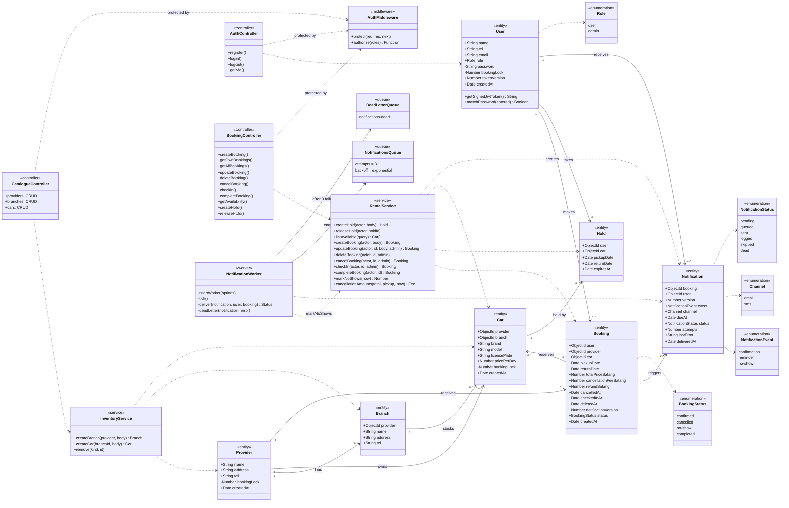
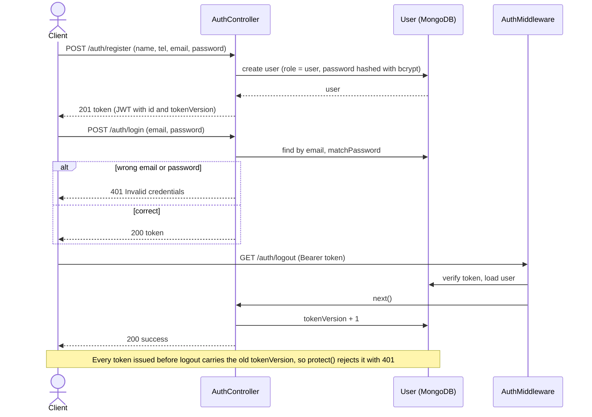
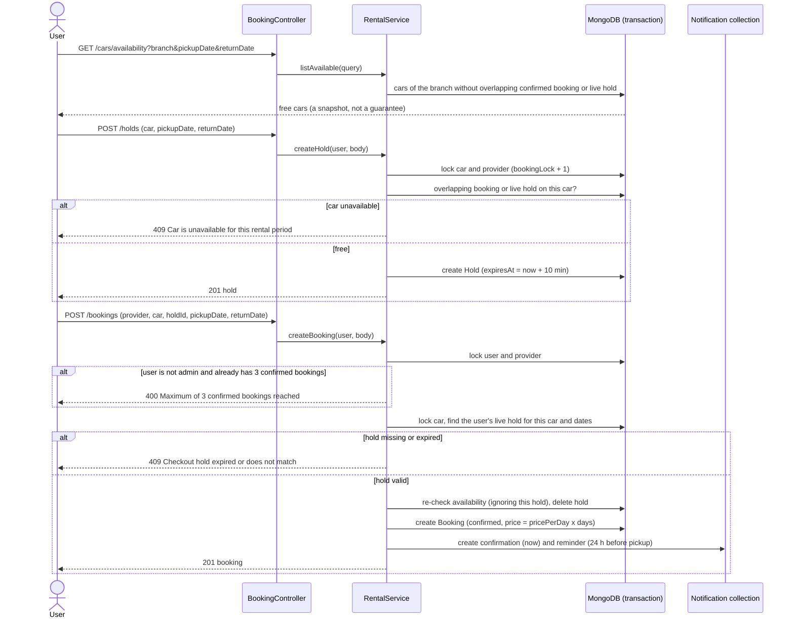
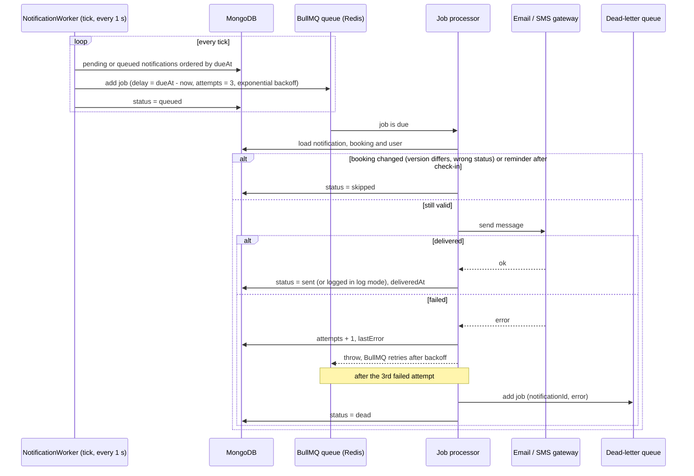
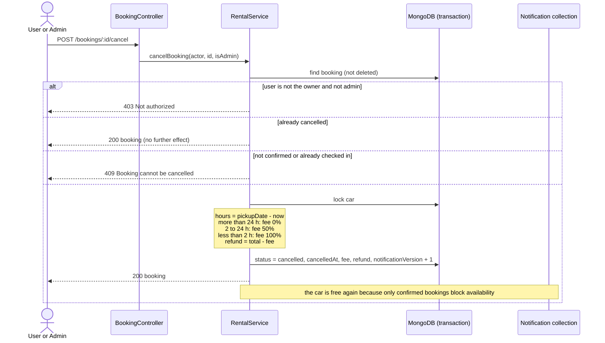
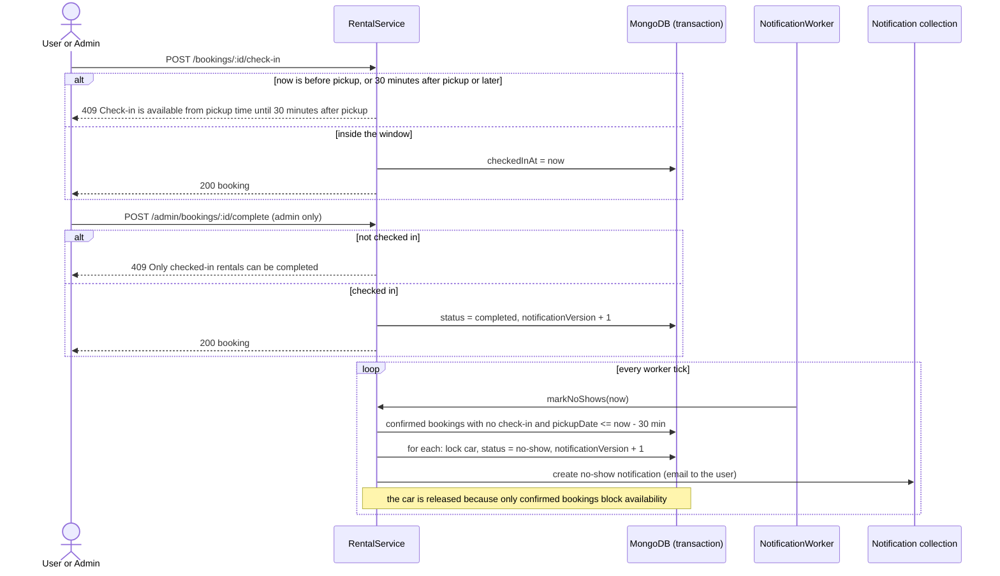

# Class Diagram and Sequence Diagrams

Sushiro Rental Car Booking REST API, 2110503 SW Dev Practice, Group 7.
Requirements and use cases: [requirements-and-use-cases.md](requirements-and-use-cases.md).

## 1. Class diagram (UML profile)

The profile uses these stereotypes:

| Stereotype | Meaning |
| --- | --- |
| `<<entity>>` | Mongoose model stored in a MongoDB collection |
| `<<service>>` | Module with business rules; every state change runs in a MongoDB transaction |
| `<<controller>>` | Express handler that reads the request and calls a service |
| `<<middleware>>` | Express middleware (authentication and authorization) |
| `<<worker>>` | Background process (BullMQ worker and scheduler) |
| `<<queue>>` | BullMQ queue in Redis |
| `<<enumeration>>` | Fixed set of values |

Attribute types are Mongoose types. `ObjectId` attributes are references to another entity. Money is stored in satang (integer).

Design notes:

- `bookingLock` on User, Provider and Car is a counter incremented inside a transaction. It forces concurrent requests on the same user, provider or car to serialize, so a car is never double booked and a user never exceeds 3 confirmed bookings.
- A `Hold` expires through a MongoDB TTL index on `expiresAt`. Availability also checks `expiresAt` itself, so an expired hold never blocks a car even before MongoDB removes it.
- `notificationVersion` on Booking is copied into each Notification. If the booking changes (edit, cancel, complete, no-show), older notifications no longer match and the worker marks them `skipped`.
- A Booking is never removed from the collection. Delete sets `deletedAt`.

## 2. Sequence diagrams

### 2.1 Register, log in and log out

### 2.2 Check availability, hold a car and create a booking

Booking only a provider (no car) skips the hold steps.

### 2.3 Send notifications with retry and dead-letter queue

Notifications are written to MongoDB inside the booking transaction, so they are not lost when Redis is down. The worker enqueues them when Redis is back.

### 2.4 Cancel a booking with a fee

### 2.5 Check in, complete and automatic no-show

