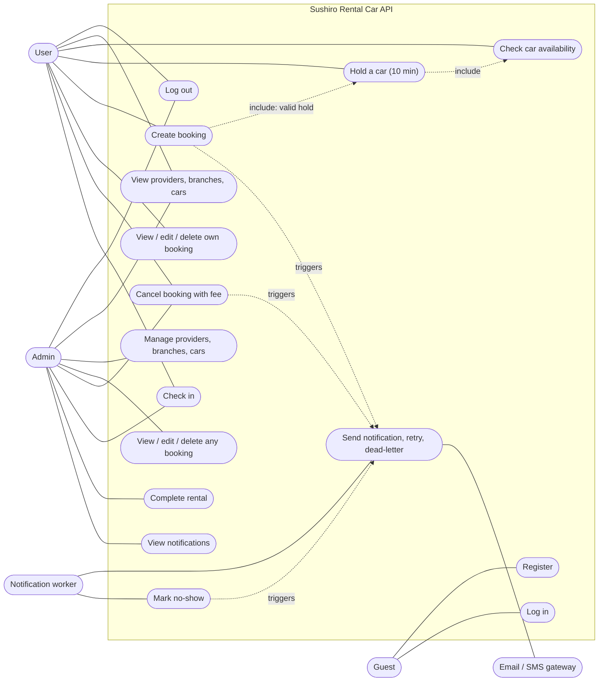

# Requirements and Use Case Diagram

Sushiro Rental Car Booking REST API, 2110503 SW Dev Practice, Group 7.
Base path of every endpoint: `/api/v1`.

## 1. Scope

A REST API (Node.js, Express, MongoDB) for booking rental cars. There is no frontend; the API is tested with Postman/Newman.
Customers register, browse rental car providers, and book cars by date and provider. Admins manage the provider catalogue and every booking.

## 2. Actors

| Actor | Description |
| --- | --- |
| Guest | Not logged in. Can only register and log in. |
| User | Logged-in customer with role `user`. Manages their own bookings. |
| Admin | Logged-in staff with role `admin` (created by the seed script, never by registration). Includes everything a User can do, plus management of any booking and of the catalogue. |
| Notification worker | Background process. Sends email/SMS through BullMQ + Redis and marks overdue bookings as no-show. |
| Email/SMS gateway | External service used by the worker (SendGrid, Twilio). |

## 3. Functional requirements

### Core

| ID | Requirement | Actor | Issue |
| --- | --- | --- | --- |
| FR-1 | A guest can register with name, tel, email and password. The role is always `user`. | Guest | #2 |
| FR-2 | A registered person can log in with email and password and receive a JWT. | Guest | #2 |
| FR-3 | A logged-in person can log out; all tokens issued before that stop working. | User, Admin | #2 |
| FR-4 | A logged-in person can view the rental car provider list (name, address, tel) and each provider's branches and cars. | User, Admin | #3 |
| FR-5 | An admin can create, edit and delete providers, branches and cars. Deleting a provider removes its branches, cars and bookings; deleting a branch removes its cars. | Admin | #3 |
| FR-6 | A user can book a car by pickup date and provider, up to 3 confirmed bookings at a time. | User | #4 |
| FR-7 | A user can view, edit and delete their own bookings. | User | #5 |
| FR-8 | An admin can view, edit and delete any booking. | Admin | #6 |

### Extra

| ID | Requirement | Actor | Issue |
| --- | --- | --- | --- |
| FR-9 | Check which cars of a branch are free for a date range. | User, Admin | #7 |
| FR-10 | Before booking a specific car, a user takes a checkout hold on it for 10 minutes. The hold is released automatically when it expires, or when the user releases it. | User | #7 |
| FR-11 | When a booking is created, the system queues a confirmation and a reminder (24 hours before pickup) by email and/or SMS. Failed sends are retried 3 times, then moved to a dead-letter queue. An admin can list notifications by status. | System, Admin | #8 |
| FR-12 | A user (or admin) can cancel a booking. A fee depends on how long before pickup the cancellation happens. The status becomes `cancelled` and the car is released. | User, Admin | #9 |
| FR-13 | A user (or admin) can check in from the pickup time until 30 minutes after it. If nobody checks in within 30 minutes after pickup, the system sets the status to `no-show`, releases the car and emails the user. | User, Admin, System | #10 |
| FR-14 | An admin can mark a checked-in rental as `completed`. | Admin | #10 |

## 4. Business rules

| Rule | Value |
| --- | --- |
| Booking limit | At most 3 bookings with status `confirmed` per user. Admins are exempt. |
| Rental period | Must start in the future, return after pickup, and last at most 90 days. If no return date is given, the rental lasts 1 day. |
| Checkout hold | 10 minutes. A booking with a specific car requires a valid hold of that same user, car and dates. |
| Price | `pricePerDay` x number of days (rounded up), stored in satang (integer). |
| Cancellation fee | More than 24 hours before pickup: 0%. Between 2 and 24 hours: 50% of the total. Less than 2 hours: 100%. The rest is refunded. |
| Cancel and edit | Only `confirmed` bookings that were not checked in can be cancelled or edited. Cancelling twice has no further effect. |
| Delete | Deleting a `confirmed` booking cancels it first, so the same fee applies, and then hides it from lists. |
| Check-in window | From pickup time up to 30 minutes after pickup. |
| No-show | `confirmed` and not checked in 30 minutes after pickup. |
| Booking status | `confirmed`, `cancelled`, `no-show`, `completed`. |
| Notification retry | 3 attempts with exponential backoff, then the dead-letter queue. A notification is skipped if the booking changed after it was queued. |

## 5. Non-functional requirements

| ID | Requirement |
| --- | --- |
| NFR-1 | Every request responds within 3 seconds. |
| NFR-2 | Authentication by email and password with a JWT (bearer header or cookie). Passwords are stored as bcrypt hashes. |
| NFR-3 | Authorization by role. Users only access their own bookings; admin-only routes return 403 for users, and 401 without a valid token. |
| NFR-4 | A car can never be double booked, and a user can never exceed 3 bookings, even with concurrent requests (MongoDB transactions). |
| NFR-5 | Notifications do not block the request; they are sent asynchronously and survive a Redis outage because they are stored in MongoDB first. |
| NFR-6 | Input is validated; unknown body fields are rejected for bookings. |

## 6. Use case diagram

Admin is also a User, so an admin can do every use case a User can.

## 7. Use case descriptions

| UC | Name | Actor | Precondition | Main flow | Endpoint |
| --- | --- | --- | --- | --- | --- |
| UC1 | Register | Guest | Email not used | Send name, tel, email, password. System creates a `user` and returns a token. | `POST /auth/register` |
| UC2 | Log in | Guest | Account exists | Send email and password. System returns a token. Wrong credentials give 401. | `POST /auth/login` |
| UC3 | Log out | User, Admin | Logged in | System invalidates every token issued so far for that account. | `GET /auth/logout` |
| UC4 | View catalogue | User, Admin | Logged in | System returns providers, branches or cars. | `GET /providers`, `/branches`, `/cars` |
| UC5 | Manage catalogue | Admin | Logged in as admin | Create, update or delete a provider, branch or car. Deleting cascades. | `POST/PUT/DELETE /providers`, `/branches`, `/cars` |
| UC6 | Check availability | User, Admin | Logged in | Send branch, pickup and return date. System lists cars with no overlapping booking or hold. | `GET /cars/availability` |
| UC7 | Hold a car | User | Car is available | System creates a hold that expires after 10 minutes. The user may release it earlier. | `POST /holds`, `DELETE /holds/:id` |
| UC8 | Create booking | User | Fewer than 3 confirmed bookings; for a specific car, a valid hold | System checks rules, creates a `confirmed` booking and queues notifications. | `POST /bookings` |
| UC9 | Manage own bookings | User | Booking belongs to the user | List, view, edit dates or provider, or delete. Other people's bookings are refused. | `/bookings`, `/bookings/:id` |
| UC10 | Manage any booking | Admin | Logged in as admin | List, view, edit or delete any booking. | `/admin/bookings`, `/admin/bookings/:id` |
| UC11 | Cancel booking | User, Admin | Booking is `confirmed` and not checked in | System computes the fee from the time before pickup, sets `cancelled`, releases the car and queues a notification. | `POST /bookings/:id/cancel` |
| UC12 | Check in | User, Admin | Within the 30-minute window | System stores the check-in time. Outside the window it returns 409. | `POST /bookings/:id/check-in` |
| UC13 | Complete rental | Admin | Booking is checked in | System sets `completed`. | `POST /admin/bookings/:id/complete` |
| UC14 | View notifications | Admin | Logged in as admin | List notifications, optionally by status (`pending`, `queued`, `sent`, `logged`, `skipped`, `dead`). | `GET /admin/notifications` |
| UC15 | Send notification | Worker | Notification is due | Worker sends through the gateway. After 3 failed attempts it moves the notification to the dead-letter queue. | background |
| UC16 | Mark no-show | Worker | 30 minutes after pickup with no check-in | Worker sets `no-show`, releases the car and queues an email to the user. | background |

## 8. Main data

User, Provider, Branch, Car, Booking, Hold and Notification. The class diagram is in issue #12.

## 9. Actions per role

| Action | Guest | User | Admin |
| --- | --- | --- | --- |
| Register, log in | yes | | |
| Log out | | yes | yes |
| View providers, branches, cars | | yes | yes |
| Create, edit, delete providers, branches, cars | | | yes |
| Check availability, hold a car | | yes | yes |
| Create booking | | yes (max 3) | yes (no limit) |
| View, edit, delete own bookings | | yes | yes |
| View, edit, delete any booking | | | yes |
| Cancel, check in | | own bookings | any booking |
| Complete rental, view notifications | | | yes |
